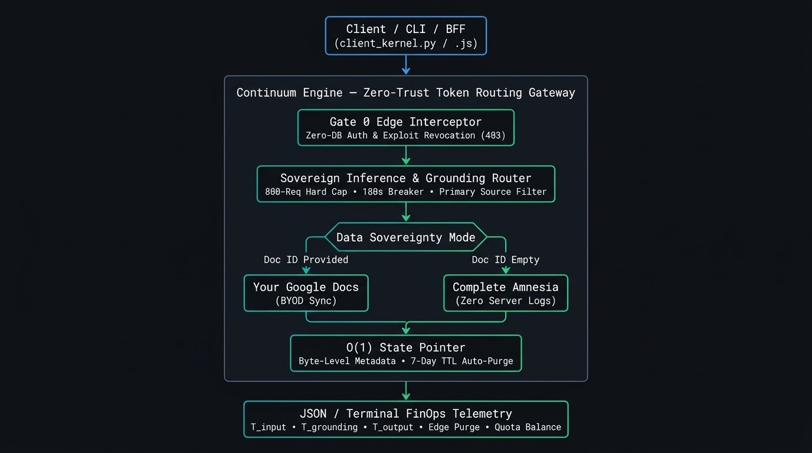

# Continuum Engine

**An Enterprise FinOps & Zero-Trust Routing Core for Agentic AI Infrastructure.**

When deploying Agentic AI or Dynamic Grounding (RAG) at scale, the underlying infrastructure often faces a critical threat: **unpredictable and invisible token runaway.** As autonomous models deeply traverse search networks and maintain massive context behind the scenes, a single user prompt can silently burn thousands of tokens, transforming your intelligent infrastructure into a deficit-generating liability.

**Continuum Engine** is an independent, client-side routing middleware (Core IP) that physically isolates and controls this token consumption at the edge layer.

By integrating this engine into your BFF (Backend For Frontend) or package environment, you can transparently visualize the "hidden labor" of Superintelligence (SI) on your terminal and strictly cap your infrastructure costs before they reach your billing account.



- **\$60 One-Time Acquisition**: Comes with a mathematically guaranteed 800-inference-rally hard cap.

- **No Subscriptions**: Secure your cloud infrastructure today, permanently.

- **Seamless Integration**: Native support for Node.js (npm), Python (pip), and direct CLI execution.

_Protected by Stripe Checkout & Zero-Trust Origin Verification_

## 1. How It Works (From Checkout to Integration in 3 Minutes)

We respect your time. Once you acquire the license, securing your infrastructure takes only three steps:

1. **Checkout & Provisioning**: Complete the \$60 transaction above. You will be immediately redirected to a secure `setup.html` console where your private API key and dedicated endpoint are instantly provisioned.

2. **Install the Client Kernel**:

   ```
   npm install continuum-engine-client
   # or
   pip install continuum-engine-client

   ```

3. **Drop it into your system**:
   Replace the variables with your provisioned credentials.

   ```
   const ContinuumClient = require("continuum-engine-client");
   const client = new ContinuumClient(
     "<YOUR_PROVISIONED_ENDPOINT>",
     "<HEADER_REVEALED_POST_PURCHASE>",
     "<YOUR_PROVISIONED_TOKEN>"
   );

   // The engine automatically purges runaway tokens and returns optimized telemetry
   const result = await client.query("Summarize the latest Zero-Trust architecture.");

   ```

## 2. FinOps Telemetry (The Edge Purge Verification)

### 🎥 Live FinOps Telemetry (Edge Purge in Action)


Engineers trust terminal logs, not marketing copy. When you route requests through the Continuum Engine, the client kernel dismantles the black box of inference costs.

It explicitly reveals the physical compute breakdown behind the model's output, exposing the "invisible labor" of dynamic grounding and proving the exact amount of CapEx saved per query.

```
==================================================
🤖 [AI RESPONSE]
==================================================
(Verified authoritative engineering response...)
--------------------------------------------------
🔗 [VERIFIED PRIMARY SOURCES]
  1. Official Cloud Architecture Documentation
     https://[Authorized-Enterprise-Domain]/...
--------------------------------------------------
🔍 [FINOPS TELEMETRY BREAKDOWN]
  ├─ T_input (Optimized Prompt)     : 210 tokens
  ├─ T_grounding (Dynamic Search)   : 4,820 tokens  <-- The hidden labor
  └─ T_output (Generated Result)    : 640 tokens

  🛡️ Edge Purge (Tokens Prevented) : 1,200 tokens
  📉 Net Billed Consumption        : 5,670 tokens
==================================================
💳 Quota Balance: 799 requests remaining
==================================================

```

## 3. Core Capabilities & Architecture

The repository distributes the open-source client kernel (`client_kernel.py` / `client-kernel.js`). This kernel connects to the Continuum Engine Core API, a closed intellectual property designed to enforce hardware-level quotas and data sovereignty.

### A. Data Sovereignty (The Power of Choice)

Based on strict Zero-Trust principles, **you retain absolute control over your data footprint.** The engine operates with two distinct memory modes:

- **Stateful Mode (BYOD - Bring Your Own Document):** By providing your Google Doc ID, the AI's inferences are automatically synced to your personal document, turning conversations into permanent knowledge assets.

- **Stateless Mode (Amnesia):** By leaving the Doc ID empty, the inference runs entirely ephemerally. Zero conversation logs are retained on our servers, flushing completely after a 7-day TTL pointer expiration.

### B. Automated Perimeter Defenses (Gate 0 & 0.5)

- **Zero-Tolerance Exploit Defense:** The engine operates a Gate 0 interceptor. Malicious payloads, prompt injections, or protocol guessing are blocked before they consume downstream resources.

- **180s Circuit Breaker:** To prevent infinite search loops during dynamic grounding, a strict 180-second hard execution limit is enforced.

_(Note: Automated vulnerability scans or prompt injection payloads will trigger immediate token revocation without refund.)_

## 4. Try the Experience (Zero-Cost Local Simulator)

If you wish to experience the "feel" of Continuum Engine's FinOps telemetry before acquiring a production license, you can run our offline simulator.

> **Note:** This demo is a completely offline simulation. It makes zero network requests to the live backend, ensuring it consumes absolutely zero infrastructure CapEx.

**For Node.js users:**

```
node run_simulator.js "What is Zero-Trust?"

```

**For Python users:**

```
python run_simulator.py "What is Zero-Trust?"

```

## 5. Operational Policies (Read Before Use)

To guarantee microsecond-level edge response and enforce strict FinOps predictability, the gateway applies non-negotiable operational controls:

- **Service Availability (Geographic Scope):** This middleware and associated API keys are exclusively intended for global enterprise environments and are **strictly not available for use or purchase within Japan**. Access from restricted jurisdictions is filtered at the gateway level.

- **Strict Quota Cap:** The 800-request quota is a mathematically enforced hard cap designed to safeguard against autonomous loop runaways. Once depleted, a new license acquisition is required.

- **Zero-Support Policy:** Engineered exclusively for experienced systems engineers building BFFs and AI infrastructures. We provide no interactive debugging, manual onboarding, or post-revocation appeals.

> 💬 **Action-Oriented Builders' Guild:** [Read the Charter & Join the Discussion here](https://github.com/individual-app-developers-cmck/continuum-engine/discussions/1)
